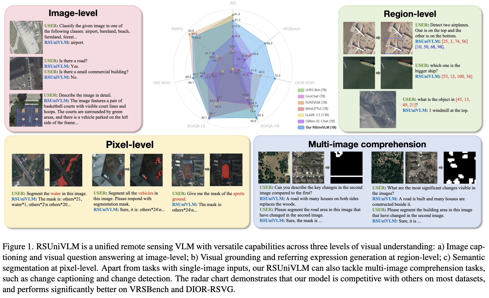

<div align="center">
<h1>RSUniVLM: A Unified Vision Language Model for Remote Sensing via Granularity-oriented Mixture of Experts</h1>

[](https://huggingface.co/spaces/liux-cyber/RSUniVLM)
[](https://rsunivlm.github.io/)
[](https://arxiv.org/abs/2412.05679)
</div>

 

---
### 📢 Latest Updates

- **2024.12.10** Release [huggingface demo](https://huggingface.co/spaces/liux-cyber/RSUniVLM)
- **2024.12.8**  Release demo code

---

### 🔨 Installation

1. Clone this repo: 
```
git clone git@github.com:xuliu-cyber/RSUniVLM.git
cd RSUniVLM
```

2. Install required Python packages

```
conda create -n rsunivlm python=3.11
conda activate rsunivlm
pip install --upgrade pip  # Enable PEP 660 support.
pip install -e ".[train]"
pip install gradio
```

### 🖼️ Demo
1. Download our available [checkpoints](https://drive.google.com/drive/folders/1TtaoOPmh167gpgHHWRNBMCaA7t_XZ4Vg?usp=sharing).
2. Change the *model_path* to your checkpoint path.
3. Execute the code to run an interactive demo on your own machine:

```
python app.py
```

### 🎉 Acknowledgement

- **Code & Model**: We build our project based on the code repo of [LLaVA-NeXT](https://github.com/LLaVA-VL/LLaVA-NeXT).

### 🧩 Citation
If you find this work useful, please cite:
、、、
@article{LIU2026113717,
title = {RSUniVLM: A unified vision-language model for remote sensing via Granularity-oriented MoE},
journal = {Pattern Recognition},
volume = {179},
pages = {113717},
year = {2026},
issn = {0031-3203},
doi = {https://doi.org/10.1016/j.patcog.2026.113717},
url = {https://www.sciencedirect.com/science/article/pii/S0031320326006825},
author = {Xu Liu and Zhouhui Lian},
keywords = {Remote sensing, Vision language model},
}
、、、
